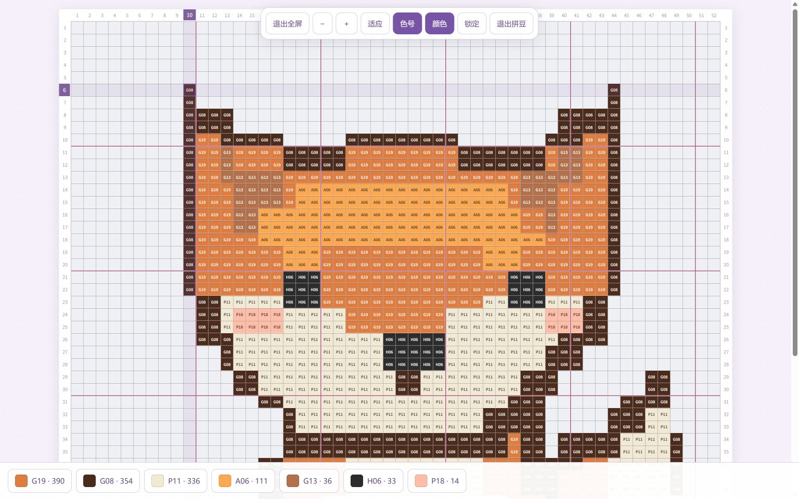

<div align="center">

# 我不是豆神

**把喜欢的图片，变成可以亲手拼出来的图纸。**

图片转拼豆 · 实体色卡匹配 · 图纸仓库 · 全屏拼装

[下载源码](https://github.com/Fisheeepolo/-/archive/refs/heads/main.zip) · [本地使用](#本地使用) · [算法研究](#算法研究) · [反馈问题](https://github.com/Fisheeepolo/-/issues)

</div>

> **开发预览版**：当前以本地构建、调试为主，尚未配置正式公开访问地址。仓库里的代码可以下载运行；GitHub 仓库页面本身不是在线制作网站。应用中文名称为「我不是豆神」，英文为「I’m Not Mr. Bean」。



## 从图片到拼豆

**新建图纸 → 命名并上传 → 预览确认 → 开始制作 → 调整并生成 → 开始拼豆**

- **先看图片，再进入编辑**：新建弹窗支持预览和更换图片，成功载入后才启用「开始制作」。名称可留空，自动分配 `未命名_01`、`未命名_02` 等编号。
- **制作中随时预览**：编辑页的「预览」提供缩放、拖动、锁定和颜色高亮，仅通过「退出预览」返回，不启动拼豆计时。
- **生成适合手工制作的图纸**：调整尺寸、主体范围、风格与用色上限；支持细节优先、均衡、好拼优先三种模式。默认保留白色豆子，外部底色移除单独控制。
- **自适应减少近似色**：均衡和好拼优先将颜色数量作为上限，改善很小时停止加色；细节优先保留精细匹配。已有图纸需重新生成才应用新算法。[算法说明与开发集对照](research/adaptive-palette/README.md)。
- **按真实色号备豆**：内置 MARD 参考色卡，统计每个色号的数量，提供近似替色和色卡导入。屏幕参考色不能代替实物色卡。
- **图纸图库**：保存原图和参数，继续编辑；点击名称重命名，删除前确认，并按难度、预计时间筛选。
- **专心拼装**：坐标定位、同色高亮、全屏放大和拖动，底部查看色号与数量。工具闲置后收起，锁定可防止误触移动或缩放。
- **记录制作时间**：支持暂停、继续、退出保存和完成记录；正在进行与已经完成分开展示。
- **导出带走**：高清 PNG 图纸、用色 CSV、逐颗坐标 CSV 和图纸 JSON 备份。

## 本地使用

### 1. 下载

点击页面上方 **Code → Download ZIP**，或使用 [源码下载链接](https://github.com/Fisheeepolo/-/archive/refs/heads/main.zip)，解压后进入包含 `package.json` 的文件夹。

也可以使用 Git：

```bash
git clone https://github.com/Fisheeepolo/-.git bead-studio
cd bead-studio
```

### 2. 安装运行环境

安装 [Node.js](https://nodejs.org/) **24.x**。网页主程序没有第三方 npm 依赖，**不需要执行 `npm install`**。

### 3. 启动

在项目文件夹打开终端。Windows 用户可以在文件资源管理器地址栏输入 `cmd` 并回车，再依次执行：

```bash
npm run build
npm run dev
```

浏览器打开 **http://127.0.0.1:5173/**。

使用期间保持终端运行，按 `Ctrl+C` 停止服务。不要直接双击 `public/index.html`；模块、色卡读取和本地服务需要通过网页地址访问。

<details>
<summary>5173 端口已被占用？</summary>

选择另一个端口，例如 5174。

Windows 命令提示符（cmd）：

```bat
set PORT=5174
npm run dev
```

PowerShell：

```powershell
$env:PORT='5174'
npm run dev
```

macOS / Linux：

```bash
PORT=5174 npm run dev
```

随后打开 `http://127.0.0.1:5174/`。浏览器按访问地址隔离本地数据；换端口后看不到旧仓库，不代表旧图纸被删除。

</details>

### 4. 更新代码后

重新执行 `npm run build`，再刷新浏览器。运行中的本地服务会读取新的构建结果。

## 数据存在哪里？

当前版本的图纸、原图、颜色资料和拼豆记录存放在**当前设备、当前网站地址对应的浏览器存储**中，没有账号云同步。

- 清除网站数据、使用另一个浏览器或换设备，都可能导致原有仓库不可见。
- 重要图纸请导出备份。**JSON 备份不包含原图**，请同时保留原始图片；它不能替代整个本地仓库的备份。
- 普通非 AI 图纸转换在浏览器中完成，不需要调用图片生成接口。
- 「东道主」是同一应用内的店家色卡演示，暂未实现店家与买家跨设备共享。
- AI 配置属于可选实验功能，编辑页的 AI 优化入口目前已隐藏。没有随项目提供 API 密钥；接入第三方服务时，图片会发送给所配置的服务商。

拼豆记录支持继续、查看和删除；删除前确认，仅删除该次记录，原图纸保留。正在其他页面计时的记录需先退出再删除。

## 全屏拼豆怎么用？

1. 从仓库选择「拼豆」，点击图纸工具栏中的「全屏拼豆」。
2. 打开时默认完整显示图纸，使用 `＋ / −` 调整大小，拖动画布查看不同区域；「适应」恢复完整图纸视图。
3. 点击底部色块高亮同色豆；「颜色」控制用色栏显示，「色号」控制格内编号显示。
4. 点击「锁定」防止误触，点击「解锁」恢复操作。闲置约 3 秒工具会收起，移动或点击工具入口可唤出。
5. 「退出全屏」返回普通拼豆布局；「退出拼豆」或普通界面的「退出」会保存累计用时并返回记录。

桌面端已实际验收。双指缩放已实现，但手机真机交互仍待验证。浏览器不支持原生全屏时，会使用铺满网页的专注视图。

## 算法研究

当前算法版本为 `content-aware-v4`，目标是在**保留图片特征**与**减少零碎难拼色块**之间取得可观察的平衡：

| 模块 | 作用 |
| --- | --- |
| 主体范围与占位分离 | 先确定处理区域，避免把白色直接等同于空白 |
| 结构加权采样 | 提升局部边缘、小特征在降采样中的影响 |
| 内容自适应抽象 | 在低细节区域平滑色彩，减少细碎渐变 |
| CIEDE2000 与受限选色 | 在实体色卡中选择不超过预算的色号 |
| 空间能量优化 | 综合色差、相邻颜色与小连通域约束 |

研究目录包含 **195 条主实验、64 条白色回归和 30 条选色补充实验**，保留了固定协议、冻结基线、消融、失败案例及复现步骤。

这是一套可复跑的研究原型，**不代表所有照片都达到最佳效果**。零碎色块率目标尚未普遍达到，一些纹理和轮廓存在取舍；难度和耗时也只是估计，不是实际手工拼装结论。

[研究入口](research/content-aware-v4/README.md) · [数学推导](research/content-aware-v4/THEORY.md) · [实测结果](research/content-aware-v4/results/RESULTS.md) · [负例与限制](research/content-aware-v4/results/DISCUSSION.md) · [复现方法](research/content-aware-v4/REPRODUCE.md)

## 开发与检查

```bash
npm test               # 算法、数据与现有功能的自动检查
npm run build          # 打包网页资源和本地服务
npm run validate       # 检查构建产物、路由和响应
npm run dev            # 启动本地预览
```

```text
public/                 网页界面、图片处理、图纸渲染与本地存储
  fullscreen-beading.js 全屏交互、锁定和底部颜色栏
  pattern-pipeline.js   图像转换流水线
  pattern-optimizer.js  受限选色与空间优化
worker/                 网页服务与可选 AI 代理
scripts/                构建、校验与本地启动脚本
tests/                  自动化测试
research/               算法推导、基准数据与实验结果
docs/images/            README 界面截图
```

现有构建包含早期托管适配配置，**构建与本地启动不会自动部署**。当前尚未配置 GitHub Pages 或其他自动发布流水线；正式部署、账号体系、共享色卡和大陆访问方案将在后续单独推进。

## 反馈与资料许可

欢迎在 [Issues](https://github.com/Fisheeepolo/-/issues) 提交问题：说明浏览器、操作步骤、期望结果和实际结果。图像转换问题可以附一张可公开的示例图片，请勿提交 API 密钥或私人照片。

色卡数据许可见 [palette-LICENSE.txt](public/palette-LICENSE.txt)，研究图片来源和许可见 [SOURCES.md](research/content-aware-v4/SOURCES.md)。这些第三方许可不等同于整个项目的统一许可；项目暂未单独声明整体开源许可证。
